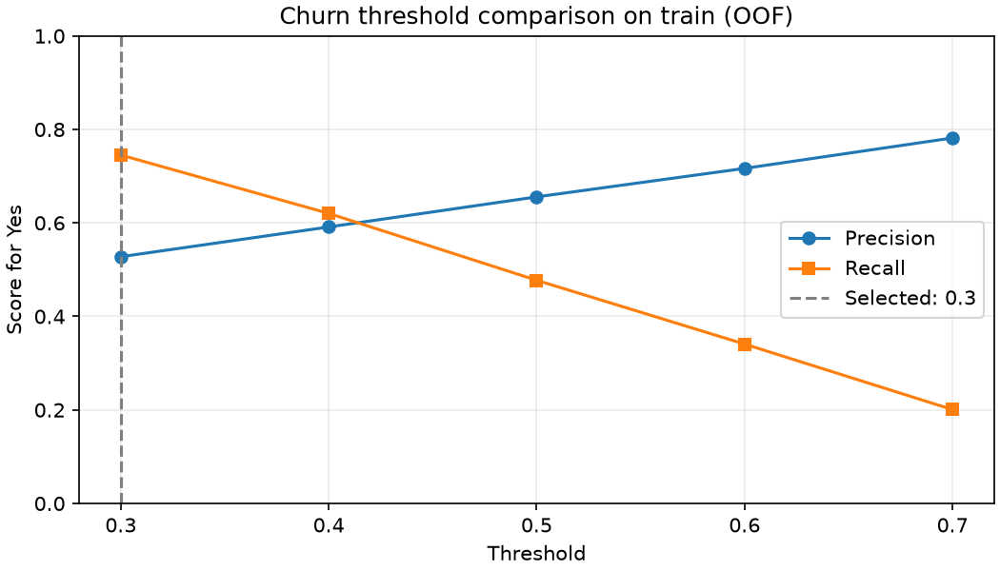
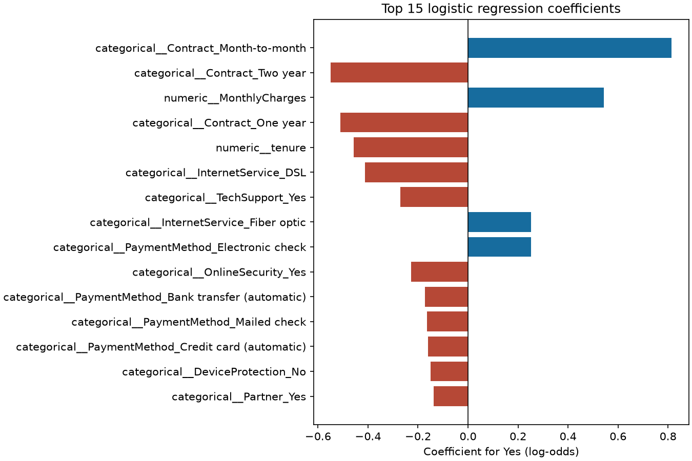
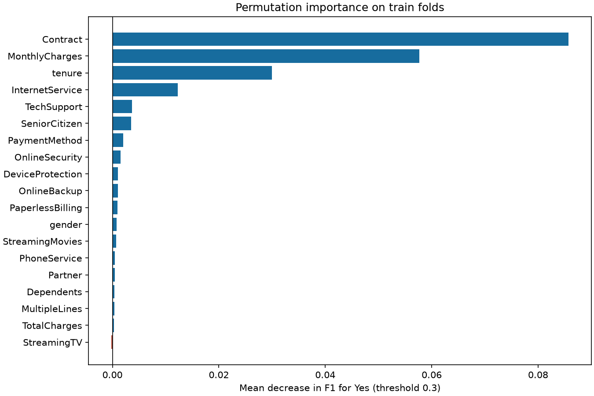

# Прогнозирование оттока клиентов

Проект сравнивает две модели логистической регрессии и случайный лес для прогнозирования оттока клиентов телеком-оператора. Такой прогноз помогает команде по удержанию выбрать, с кем связаться в первую очередь. Пропустить клиента, который собирается уйти, и обратиться к клиенту, который и так останется, — ошибки с разной стоимостью.

## Данные

Проект использует **искусственный датасет** `data/synthetic/synthetic_customer_churn.csv`. В нём 10 000 вымышленных клиента, из которых 3 032 получили метку оттока (30,32%). Генератор не читает исходный датасет и создаёт идентификаторы вида `SYN-00001`.

`generate_dataset.py` использует NumPy и seed 42. У клиентов с большим стажем чаще встречаются долгосрочные договоры. Подключённые услуги и скидки за договор определяют ежемесячную плату. Накопленная плата зависит от стажа и ежемесячной платы с поправкой на изменение тарифов. После генерации признаков скрипт вычисляет вероятность оттока по стажу, договору, платежам и услугам с добавлением шума. Затем он выбирает метку `Churn` по этой вероятности.

## Методика

Проект использует Python, pandas, NumPy и scikit-learn.

1. Исключаем `customerID` и отделяем целевую переменную от признаков. Преобразуем `TotalCharges` в числовой столбец. Пустые и некорректные значения считаем пропусками.
2. Делим данные на обучающую и тестовую выборки в пропорции 80/20 со стратификацией по `Churn` и `random_state=42`. В обучающей выборке 8 000 строки, в тестовой — 2 000.
3. Заполняем числовые пропуски нулями и стандартизируем числовые признаки для логистической регрессии. Генератор сохраняет нулевые накопленные суммы при нулевом стаже и не добавляет пропусков.
4. Кодируем категории с помощью `OneHotEncoder`. Для незнакомой категории все закодированные столбцы соответствующего признака получают нули. Обучаем преобразования только на обучающей выборке и применяем их к тестовой.
5. На одинаковых данных обучаем две логистические регрессии и случайный лес из 100 деревьев с `random_state=42`. Для леса сохраняем заполнение пропусков и one-hot кодирование, масштабирование пропускаем. В базовой модели все наблюдения имеют одинаковый вес. В модели с балансировкой веса классов обратно пропорциональны их частотам в обучающей выборке.

## Кросс-валидация

Все три модели сравниваются на одних и тех же пяти стратифицированных фолдах только внутри 8 000 обучающих строк. В каждом фолде `Pipeline` с `ColumnTransformer` заново обучает кодировщик, заполнение пропусков и, для логистической регрессии, масштабирование на обучающей части фолда. Тестовая выборка из 2 000 строк используется для итоговой оценки всех трёх конфигураций после обучения на полном train. Подбор параметров по test не выполняется.

Среднее ± стандартное отклонение по пяти фолдам для класса `Yes`:

| Модель | F1 | Precision | Recall |
| --- | ---: | ---: | ---: |
| Без весов классов | 0.5525 ± 0.0159 | 0.6562 ± 0.0227 | 0.4773 ± 0.0165 |
| С балансировкой | 0.6177 ± 0.0058 | 0.5296 ± 0.0046 | 0.7411 ± 0.0140 |
| Random Forest | 0.5225 ± 0.0078 | 0.6121 ± 0.0022 | 0.4559 ± 0.0127 |

## Результаты

Все три модели оценены на одной тестовой выборке. Precision, recall и F1 рассчитаны для класса оттока (`Yes`).

| Модель | Accuracy | Precision | Recall | F1 | ROC-AUC |
| --- | ---: | ---: | ---: | ---: | ---: |
| Без весов классов | 0.7585 | 0.6370 | 0.4719 | 0.5422 | 0.8032 |
| С балансировкой | 0.7270 | 0.5361 | 0.7343 | 0.6198 | 0.8032 |
| Random Forest | 0.7510 | 0.6195 | 0.4620 | 0.5293 | 0.7815 |

В матрицах ошибок положительный класс — `Yes`. При запуске скрипта строки соответствуют фактическим классам, столбцы — предсказанным. Порядок по обеим осям — `No`, `Yes`.

| Модель | Верно предсказали отсутствие оттока | Ложные срабатывания | Пропущенные случаи оттока | Верно обнаружили отток |
| --- | ---: | ---: | ---: | ---: |
| Без весов классов | 1231 | 163 | 320 | 286 |
| С балансировкой | 1009 | 385 | 161 | 445 |
| Random Forest | 1222 | 172 | 326 | 280 |

Случайный лес уступил обеим логистическим регрессиям по F1 и recall как на кросс-валидации, так и на test. На test он обнаружил 280 из 606 случаев оттока, а логистическая регрессия с балансировкой — 445. Логистическая регрессия без весов показала наибольшую precision. ROC-AUC рассчитан по вероятностям класса `Yes`.

## Выбор порога для логистической регрессии без весов

Для каждой строки train получили вероятность класса `Yes` от модели, которая не обучалась на этой строке. Использовали те же пять стратифицированных фолдов и заново обучали весь `Pipeline` внутри каждого фолда. Метрики ниже рассчитаны по объединённым out-of-fold предсказаниям на 8 000 строках. Из пяти вариантов выбрали порог **0.3** по максимальному F1. Затем обучили модель на полном train и оценили выбранный порог на test один раз.

| Порог | Precision | Recall | F1 |
| ---: | ---: | ---: | ---: |
| 0.3 | 0.5277 | 0.7453 | **0.6179** |
| 0.4 | 0.5914 | 0.6204 | 0.6055 |
| 0.5 | 0.6557 | 0.4773 | 0.5525 |
| 0.6 | 0.7166 | 0.3409 | 0.4620 |
| 0.7 | 0.7817 | 0.2007 | 0.3194 |



На test порог 0.3 дал accuracy **0.7295**, precision **0.5387**, recall **0.7459**, F1 **0.6256** и ROC-AUC **0.8032**. Матрица ошибок в порядке `[[TN, FP], [FN, TP]]` — `[[1007, 387], [154, 452]]`. Модель обнаружила 452 из 606 случаев оттока против 445 у логистической регрессии с балансировкой и 280 у случайного леса. ROC-AUC логистической регрессии без весов остался прежним, поскольку порог меняет метки, а вероятности остаются прежними.

## Важность признаков

Коэффициенты взяты из логистической регрессии без весов, обученной на всех 8 000 строках train. Имена получены из обученного `ColumnTransformer`. Знак коэффициента показывает, как признак меняет логарифм шансов оттока при прочих равных. Для числовых признаков шаг равен одному стандартному отклонению. Для категорий полезно сравнивать коэффициенты внутри одного исходного столбца, поскольку кодировщик сохраняет все категории. Порог 0.3 меняет правило присвоения метки, а коэффициенты остаются прежними.

| Признак после преобразования | Коэффициент |
| --- | ---: |
| Contract = Month-to-month | +0.8149 |
| Contract = Two year | −0.5492 |
| MonthlyCharges | +0.5426 |
| Contract = One year | −0.5104 |
| tenure | −0.4566 |
| InternetService = DSL | −0.4119 |
| TechSupport = Yes | −0.2700 |
| InternetService = Fiber optic | +0.2527 |
| PaymentMethod = Electronic check | +0.2524 |
| OnlineSecurity = Yes | −0.2276 |
| PaymentMethod = Bank transfer (automatic) | −0.1730 |
| PaymentMethod = Mailed check | −0.1634 |
| PaymentMethod = Credit card (automatic) | −0.1608 |
| DeviceProtection = No | −0.1489 |
| Partner = Yes | −0.1381 |



Для permutation importance перемешивали каждый исходный столбец отдельно на валидационной части каждого из пяти фолдов train. Использовали модели соответствующих фолдов, порог 0.3 и 10 повторов с `random_state=42`. Среднее снижение F1 класса `Yes` составило **0.0857** для `Contract`, **0.0577** для `MonthlyCharges`, **0.0300** для `tenure`, **0.0123** для `InternetService` и **0.0037** для `TechSupport`.



Коэффициенты показывают направление связи, а перемешивание измеряет вклад исходного столбца в качество предсказаний при выбранном пороге. Например, помесячный договор и более высокая плата повышают оценку риска, а больший стаж её снижает. Связанные признаки могут дублировать информацию, а перемешивание может создавать нетипичные комбинации. Результаты описывают модель на синтетических данных. Test при анализе важности не использовался.

## Запуск

Выполняй команды из корня проекта. Эксперимент проверен на Python 3.13.7. Синтетический CSV входит в репозиторий. Строка с генератором позволяет воспроизвести этот файл.

```powershell
python -m venv .venv
.venv\Scripts\python.exe -m pip install -r requirements.txt
.venv\Scripts\python.exe generate_dataset.py
.venv\Scripts\python.exe main.py
```

На macOS или Linux в последних трёх командах используй `.venv/bin/python`.

## Прогноз для одного клиента

Сохрани одну строку синтетического CSV в `customer.json` как JSON-объект. Ключи должны совпадать с заголовками CSV, кроме `customerID` и `Churn`, которые можно опустить. Числовые значения записывай числами, категории — строками.

```powershell
.venv\Scripts\python.exe main.py
.venv\Scripts\python.exe predict.py customer.json
```

Первая команда сохраняет Pipeline логистической регрессии без весов и выбранный на train порог 0.3 в `models/logistic_regression.joblib`. Вторая выводит вероятность `Churn=Yes`, порог и итоговый класс. Загружай только файл, который создал сам в доверенном окружении. Загрузка чужого joblib-файла может выполнить произвольный код.

## Локальный интерфейс Streamlit

Установи зависимости командой `python -m pip install -r requirements.txt` в виртуальном окружении. После клонирования один раз запусти `python main.py`. Скрипт создаст `models/logistic_regression.joblib` на основе синтетического CSV, включённого в репозиторий. Файл модели хранится локально и исключён из Git. Используй только доверенный артефакт.

```powershell
.venv\Scripts\python.exe -m streamlit run app.py --server.address 127.0.0.1
```

Открой http://127.0.0.1:8501, заполни форму и нажми «Рассчитать вероятность». Приложение загружает сохранённый Pipeline и показывает вероятность оттока, класс и порог. На macOS или Linux используй `.venv/bin/python`.

## Тесты

Из корня проекта установи зависимости для разработки и запусти тесты:

```powershell
.venv\Scripts\python.exe -m pip install -r requirements-dev.txt
.venv\Scripts\python.exe -m pytest -q
```

На macOS или Linux используй `.venv/bin/python`. Тесты создают данные в памяти и проверяют генератор и Pipeline без чтения тестовой выборки основного эксперимента.

## Ограничения

- Результаты одного тестового разбиения показывают, насколько хорошо модели улавливают зависимости, заданные генератором. Они не подтверждают качество прогноза на реальных клиентах или будущих периодах.
- Порог 0.3 дал лучший F1 среди пяти проверенных значений. OOF F1 выбранного порога использовался при подборе. Небольшой выигрыш на одном тестовом разбиении может не повториться. Для рабочей кампании порог следует оценить на новых данных с учётом стоимости пропущенного оттока и лишнего контакта.

---

# Customer Churn Prediction

This project compares two logistic regression models and a random forest for predicting whether a telecom customer will churn. A retention team could use churn predictions to prioritize outreach. Missing an at-risk customer and contacting a customer who would stay have different costs, so the comparison reports both types of error.

## Dataset

The project uses an **artificial dataset** at `data/synthetic/synthetic_customer_churn.csv`. It contains 10,000 fictional customers, including 3,032 labeled as churned (30.32%). The generator creates identifiers such as `SYN-00001` and reads no source records.

`generate_dataset.py` uses NumPy with seed 42. Longer-tenure customers are more likely to have long-term contracts. Subscribed services and contract discounts determine monthly charges. Total charges scale with tenure and monthly charges, with variation to approximate historical billing changes. After building the features, the generator calculates churn probability from tenure, contract, charges, and services, with an independent noise term. It then samples the `Churn` label from that probability.

## Method

The project uses Python, pandas, NumPy, and scikit-learn.

1. Exclude `customerID` and separate the target from the features. Parse `TotalCharges` as numeric, treating blanks and invalid entries as missing.
2. Create a stratified 80/20 train/test split with `random_state=42` (8,000 training rows and 2,000 test rows).
3. Fill numeric missing values with zero if present and standardize numeric features for logistic regression. The generated dataset has no missing values and uses a total charge of zero for zero-tenure customers.
4. One-hot encode categorical features. An unseen category produces zeros for that feature's encoded columns. Fit all preprocessing on training data and reuse the fitted transformations on test data.
5. Train two logistic regression models and a 100-tree random forest with `random_state=42` on the same training rows. The forest uses imputation and one-hot encoding without scaling. The unweighted baseline gives observations equal weight. The balanced model weights classes inversely to their training frequencies.

## Cross-validation

All three models use the same five stratified folds within the 8,000 training rows. In each fold, a `Pipeline` with a `ColumnTransformer` fits encoding, imputation, and scaling (for logistic regression) on the fold's training portion. All three configurations are then fitted on the full training set and evaluated on the 2,000 held-out test rows. The test set is reserved for final evaluation.

Mean ± standard deviation across five folds for the `Yes` class:

| Model | F1 | Precision | Recall |
| --- | ---: | ---: | ---: |
| Unweighted | 0.5525 ± 0.0159 | 0.6562 ± 0.0227 | 0.4773 ± 0.0165 |
| Balanced | 0.6177 ± 0.0058 | 0.5296 ± 0.0046 | 0.7411 ± 0.0140 |
| Random Forest | 0.5225 ± 0.0078 | 0.6121 ± 0.0022 | 0.4559 ± 0.0127 |

## Results

All three models use the same held-out test set. Precision, recall, and F1 are reported for churn (`Yes`).

| Model | Accuracy | Precision | Recall | F1 | ROC-AUC |
| --- | ---: | ---: | ---: | ---: | ---: |
| Unweighted | 0.7585 | 0.6370 | 0.4719 | 0.5422 | 0.8032 |
| Balanced | 0.7270 | 0.5361 | 0.7343 | 0.6198 | 0.8032 |
| Random Forest | 0.7510 | 0.6195 | 0.4620 | 0.5293 | 0.7815 |

Confusion matrix counts use `Yes` as the positive class. The script prints matrices with actual classes as rows and predicted classes as columns, both in `No`, `Yes` order.

| Model | True negatives | False positives | False negatives | True positives |
| --- | ---: | ---: | ---: | ---: |
| Unweighted | 1231 | 163 | 320 | 286 |
| Balanced | 1009 | 385 | 161 | 445 |
| Random Forest | 1222 | 172 | 326 | 280 |

Random Forest had lower F1 and recall than both logistic regression models in cross-validation and on the test set. It detected 280 of 606 test churn cases, compared with 445 for balanced logistic regression. Unweighted logistic regression had the highest precision. ROC-AUC uses predicted probabilities for the `Yes` class.

## Threshold selection for unweighted logistic regression

Each training row received a probability for the `Yes` class from a model that did not train on that row. The full pipeline was refitted within each of the same five stratified folds. The metrics below use pooled out-of-fold predictions for all 8,000 training rows. Threshold **0.3** maximized F1 among the five candidates. The model was then fitted on the full training set and the selected threshold was evaluated once on the held-out test set.

| Threshold | Precision | Recall | F1 |
| ---: | ---: | ---: | ---: |
| 0.3 | 0.5277 | 0.7453 | **0.6179** |
| 0.4 | 0.5914 | 0.6204 | 0.6055 |
| 0.5 | 0.6557 | 0.4773 | 0.5525 |
| 0.6 | 0.7166 | 0.3409 | 0.4620 |
| 0.7 | 0.7817 | 0.2007 | 0.3194 |


On the test set, threshold 0.3 produced accuracy **0.7295**, precision **0.5387**, recall **0.7459**, F1 **0.6256**, and ROC-AUC **0.8032**. The confusion matrix in `[[TN, FP], [FN, TP]]` order is `[[1007, 387], [154, 452]]`. It detected 452 of 606 churn cases, compared with 445 for balanced logistic regression and 280 for Random Forest. ROC-AUC for unweighted logistic regression stayed the same because thresholding changes the predicted labels while leaving the probabilities unchanged.

## Feature importance

Coefficients come from the unweighted logistic regression fitted on all 8,000 training rows. Feature names come from its fitted `ColumnTransformer`. The sign describes how a feature changes churn log-odds with other inputs held fixed. Numeric coefficients are per standard deviation. For one-hot features, compare levels within the same input column because all levels are retained. The 0.3 threshold changes the label decision while leaving the coefficients unchanged.

| Transformed feature | Coefficient |
| --- | ---: |
| Contract = Month-to-month | +0.8149 |
| Contract = Two year | −0.5492 |
| MonthlyCharges | +0.5426 |
| Contract = One year | −0.5104 |
| tenure | −0.4566 |
| InternetService = DSL | −0.4119 |
| TechSupport = Yes | −0.2700 |
| InternetService = Fiber optic | +0.2527 |
| PaymentMethod = Electronic check | +0.2524 |
| OnlineSecurity = Yes | −0.2276 |
| PaymentMethod = Bank transfer (automatic) | −0.1730 |
| PaymentMethod = Mailed check | −0.1634 |
| PaymentMethod = Credit card (automatic) | −0.1608 |
| DeviceProtection = No | −0.1489 |
| Partner = Yes | −0.1381 |


Permutation importance shuffles one original input column at a time on each of the five training-set validation folds. It uses the corresponding fold model, threshold 0.3, and 10 repeats with `random_state=42`. Mean drops in F1 for `Yes` were **0.0857** for `Contract`, **0.0577** for `MonthlyCharges`, **0.0300** for `tenure`, **0.0123** for `InternetService`, and **0.0037** for `TechSupport`.


Coefficients describe direction, while permutation importance measures how much predictive performance depends on a column at the selected threshold. Month-to-month contracts and higher monthly charges raise estimated churn risk, while longer tenure lowers it. Correlated features can share predictive information, and shuffling may produce unusual combinations. These results describe a model trained on synthetic data. Feature importance was computed without the test set.

## Run locally

Run these commands from the project root. The experiment was verified with Python 3.13.7. The synthetic CSV is included in the repository. Run the generator to reproduce it.

```powershell
python -m venv .venv
.venv\Scripts\python.exe -m pip install -r requirements.txt
.venv\Scripts\python.exe generate_dataset.py
.venv\Scripts\python.exe main.py
```

On macOS or Linux, use `.venv/bin/python` in the last three commands.

## Predict churn for one customer

Save one row from the synthetic CSV as a JSON object in `customer.json`. Use the CSV header names as keys. You can omit `customerID` and `Churn`. Use JSON numbers for numeric fields and strings for categories.

```powershell
.venv\Scripts\python.exe main.py
.venv\Scripts\python.exe predict.py customer.json
```

The first command saves the unweighted logistic regression pipeline and its training-selected threshold of 0.3 to `models/logistic_regression.joblib`. The second prints the probability of `Churn=Yes`, the threshold, and the predicted label. Load only an artifact you generated in a trusted environment. Loading an untrusted joblib file can execute arbitrary code.

## Local Streamlit app

Install the dependencies with `python -m pip install -r requirements.txt` in your virtual environment. After cloning, run `python main.py` once to generate `models/logistic_regression.joblib` from the included synthetic CSV. Git ignores the locally generated model file. Use only a trusted artifact.

```powershell
.venv\Scripts\python.exe -m streamlit run app.py --server.address 127.0.0.1
```

Open http://127.0.0.1:8501, fill in the customer form, and submit it to see the churn probability, class, and threshold. The interface is in Russian and uses the saved pipeline. On macOS or Linux, use `.venv/bin/python`.

## Tests

From the project root, install the development dependencies and run the tests:

```powershell
.venv\Scripts\python.exe -m pip install -r requirements-dev.txt
.venv\Scripts\python.exe -m pytest -q
```

On macOS or Linux, use `.venv/bin/python`. The tests generate data in memory and exercise the generator and pipeline without reading the main experiment's holdout set.

## Limitations

- A single holdout split measures how well the models recover relationships built into the simulator. These metrics do not establish performance on real customers or future periods.
- Threshold 0.3 had the best F1 among the five tested values. Its OOF F1 was used in selection. The small gain on one holdout split may not repeat. A deployment threshold should be evaluated on new data and account for the costs of missed churn and unnecessary outreach.
